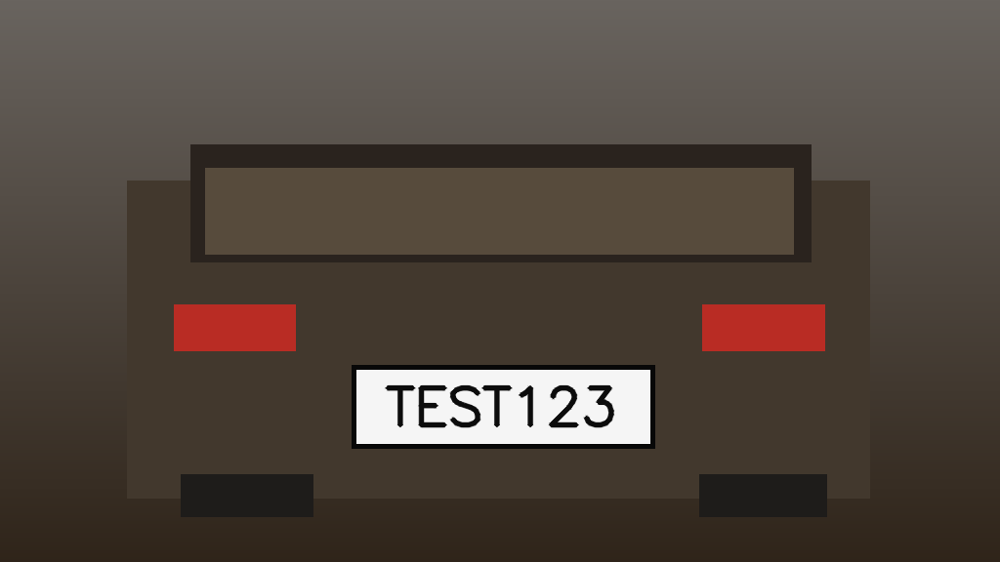

# Embedded C++ License Plate Recognition (ALPR) — Prototype

A **C++17** object-oriented automatic license-plate recognition learning project,
using **OpenCV** for image/video capture and rectangular plate candidates,
**Tesseract OCR** for reading plate text, and **CMake + CTest** for builds and tests.
Designed to start on a Linux laptop/WSL and later run on a **Raspberry Pi 5**.

> **Current status (Oct 26, 2026):** The user built the complete C++ app with
> OpenCV 4.6.0 and Tesseract 5.3.4 under WSL Ubuntu. Core CTest passed, and the
> native C++ program read the included synthetic plate `TEST123` with 85 OCR
> confidence (54.26 ms processing time on that run). Nine downloaded 200x50
> reference **plate crops** yielded text on eight images only with confidence
> threshold set to **0**, and all nine `auto` detection runs found no candidates.
> Those OCR strings are NOT verified ground truth. This release adds **experimental**
> robust OCR preprocessing; it has not yet been compiled or measured on the user's
> nine images. Real-image accuracy and Raspberry Pi deployment remain unverified.



## What it does

- Processes JPG/PNG, video files, and camera indices supported by OpenCV.
- Proposes plate-shaped rectangles using Canny edges and bright-region contours.
- Crops candidate regions and runs local Tesseract OCR.
- Normalizes OCR text, applies a simplified plate-format heuristic, and filters
  repeated detections within a five-second cooldown.
- Records timestamp, recognized text, OCR confidence and processing time to CSV.
- Optionally saves an annotated frame.

**Limitations:** Heuristic plate detection is fragile on real road footage,
angled plates and poor lighting. OCR confidence is **not** an accuracy percentage.
Only the first plausible plate per frame is emitted. Numeric-only plates are
  accepted only with `--allow-numeric-only`. Already-cropped plate images can be
  passed using `--plate-crop`. This is a software
engineering prototype, **not** a trained ALPR model or production surveillance tool.

## Build locally on Windows using WSL2 (recommended)

WSL provides a Linux toolchain close to the Raspberry Pi build environment.
In **PowerShell as Administrator**, install WSL if you have not already:

```powershell
wsl --install -d Ubuntu
```

Reboot if prompted. Open **Ubuntu** from the Windows Start menu, then:

```bash
sudo apt update
sudo apt install -y build-essential cmake pkg-config git unzip \
    libopencv-dev libtesseract-dev tesseract-ocr-eng
```

Unzip the downloaded project to your WSL home directory or use `git clone`
after pushing your repo to GitHub. From the project folder:

```bash
cmake -S . -B build -DCMAKE_BUILD_TYPE=Release
cmake --build build -j2
ctest --test-dir build --output-on-failure
./build/alpr --input samples/synthetic_plate.png \
    --output results/events.csv --annotated results/annotated.png
```

Expected output **if the C++ detector/OCR path works**:

```text
[ALERT] plate=TEST123 ocr_confidence=... processing_ms=...
```

Check `results/events.csv` and `results/annotated.png`. The C++ executable
returns `2` if it runs without recognizing a plate (not a crash). If it does not
recognize the supplied synthetic image, please open an issue with your OS,
OpenCV and Tesseract versions and the console output.

## Build on Raspberry Pi 5 (later stage)

Run the same `apt`/`cmake` commands on a current 64-bit Raspberry Pi OS.
First confirm your camera works outside this app with:

```bash
rpicam-hello --timeout 3000
rpicam-still --output pi_photo.jpg
./build/alpr --input pi_photo.jpg --annotated results/pi_photo_result.png
```

A captured image **may not have a plate**, so `No valid plate recognized` is
normal. For local video/camera support, try `--input path/to/video.mp4` or
`--camera 0` only after you verify that OpenCV can open the selected device.
Pi CSI cameras are **not guaranteed to be `/dev/video0`**; a libcamera/V4L2
pipeline may be necessary. Native live CSI camera integration and Pi benchmarking
are follow-up work, not claimed as completed.

## Commands

```bash
./build/alpr --help
./build/alpr --input samples/synthetic_plate.png
./build/alpr --input samples/drive.mp4 --max-frames 100
./build/alpr --camera 0 --max-frames 100
./build/alpr --input samples/synthetic_plate.png --min-confidence 25 --annotated results/preview.png
```

If you **only want to compile and test platform-independent C++ components**
without OpenCV and Tesseract developer libraries installed:

```bash
cmake -S . -B build-core -DALPR_BUILD_APP=OFF -DCMAKE_BUILD_TYPE=Release
cmake --build build-core -j2
ctest --test-dir build-core --output-on-failure
```

## Code structure

```text
include/alpr/       Public headers
src/                C++ implementation and CLI
samples/            Synthetic plate image (not a real individual's plate)
tests/              Dependency-free C++ logic checks
.github/workflows/  GitHub Actions Ubuntu build/test pipeline
docs/               Architecture and limitations
results/            Generated CSV/images (gitignored)
```

See [Architecture](docs/architecture.md) for component responsibilities and
future extension ideas.

## Publish to GitHub

Install [GitHub CLI](https://cli.github.com/) and authenticate (or create a repo
via GitHub's website). From inside this extracted folder:

```bash
git init
git add .
git commit -m "Initial C++ ALPR prototype with tests"
git branch -M main
gh auth login
gh repo create embedded-cpp-license-plate-recognition --public --source=. --remote=origin --push
```

Run the GitHub Actions checks to confirm that the full C++ build/tests and
synthetic sample smoke test work in Ubuntu before considering the project complete.

## Responsible use

Use generated or permissioned vehicle imagery. Avoid committing identifiable
license plate photos or event logs. This prototype has no cloud upload or
identity lookup. Do not use the heuristic output to make consequential decisions.

## References

- [OpenCV C++ documentation](https://docs.opencv.org/4.x/)
- [Tesseract C++ API](https://tesseract-ocr.github.io/tessdoc/Examples_C%2B%2B.html)
- [Raspberry Pi Camera software](https://www.raspberrypi.com/documentation/computers/camera_software.html)

MIT license. All core project source was written for this starter; it is not a
copy of a third-party GitHub ALPR repository.

## Reference images from Luca Meschiari's C++ project

The repository [LucaMeschiari/LicensePlateRecognition](https://github.com/LucaMeschiari/LicensePlateRecognition)
contains nine sample license-plate JPEGs. We use them **as separate local evaluation
inputs, not as code to copy**. Its algorithm is an older contour-and-feature-based
numeric recognizer; this C++17 project uses its own OpenCV plate-candidate logic
and Tesseract OCR with RAII-based components.

```bash
python3 scripts/fetch_reference_images.py
python3 scripts/evaluate_reference.py --binary ./build/alpr --mode both
```

The downloader and test script generate `results/reference_report.csv` with
predictions for each image. To report accuracy, you must **manually verify labels**
and supply a CSV; see [Reference evaluation](docs/reference-evaluation.md).
Third-party sample JPEGs are gitignored and not included in the ZIP.

If an input is an **already cropped plate** instead of a vehicle photo, bypass
the localization step explicitly:

```bash
./build/alpr --input tests/reference_images/LicensePlate1.jpg \
    --plate-crop --allow-numeric-only \
    --output results/crop_events.csv
```

This mode demonstrates OCR, **not automatic plate detection**. The digit-only flag
reflects the limited numeric plate formats in older demonstrations; real plate
rules vary by region.


## Debugging reference images

See [`docs/debugging.md`](docs/debugging.md). The `--debug` and `--debug-dir` options print OCR decisions and save candidate crops.

## Diagnosing tiny historical plate crops (v3)

Luca's nine 200x50 reference JPEGs are **already cropped license plates**;
use `--plate-crop` to test OCR, not `auto` detection. The old diagnostic run
returned zero confidence for all readable strings. The earlier run used
`--min-confidence 0`, which intentionally bypassed the confidence gate; it did
**not** establish eight correct predictions.

This update adds an **optional slower offline OCR mode** with upscaling,
padding, contrast enhancement (CLAHE), Otsu thresholding, inversion, and
adaptive thresholding. It outputs each variant and saves its intermediate image
with `--debug-dir`, so you can see what Tesseract actually sees. Because each
variant runs OCR, `--ocr-robust` is not meant for real-time video.

Run against the nine locally downloaded crops:

```bash
cmake -S . -B build -DCMAKE_BUILD_TYPE=Release
cmake --build build -j2
ctest --test-dir build --output-on-failure
python3 scripts/evaluate_reference.py --mode crop --ocr-robust \
  --min-confidence 20 --debug > results/robust_debug_report.txt 2>&1
cat results/reference_report.csv
```

Inspect one failure (including preprocessing intermediates):

```bash
./build/alpr --input tests/reference_images/LicensePlate6.jpg \
  --plate-crop --allow-numeric-only --ocr-robust \
  --min-confidence 20 --debug --debug-dir results/debug/plate6
```

Set `--min-confidence 0` *only* while diagnosing rejected strings; never treat
zero-confidence OCR as evidence of accuracy. To measure exact-match accuracy,
provide a manually verified label CSV via `--truth path/to/truth.csv`.
# embedded-cpp-license-plate-recognition
